  

 

  
  
  
  
  

## 👨‍💻 About

I'm a **Software Engineer** from Bangladesh who designs and builds scalable backend systems and cloud-native applications. I'm graduated in B.Sc. in Computer Science and Engineering from **Ahsanullah University of Science and Technology**, with a focus on software architecture, system design, and problem solving and currently working on production level systems.

- 🔭 Building: scalable APIs and backend services
- 🌱 Learning: **DevOps, Kubernetes & Cloud engineering**
- 💬 Ask me about: **C#, system design & problem solving**
- ☕ Fun fact: powered by tea & coffee

 

## 🛠️ Tools & Technologies

| Category | Stack |
|:--|:--|
| **Languages** |      |
| **Frameworks** |     |
| **Databases** |      |
| **Deployment & DevOps** |      |

 

## 📊 GitHub Stats

  
  

  

 

## 📈 Contribution Activity

  <picture>
    <source media="(prefers-color-scheme: dark)" srcset="https://raw.githubusercontent.com/ashikulislamm/github-stats/main/profile-3d-contrib/profile-night-rainbow.svg"/>
    <source media="(prefers-color-scheme: light)" srcset="https://raw.githubusercontent.com/ashikulislamm/github-stats/main/profile-3d-contrib/profile-green.svg"/>
    
  </picture>

Thanks for visiting. Let's build something great together. 🚀

